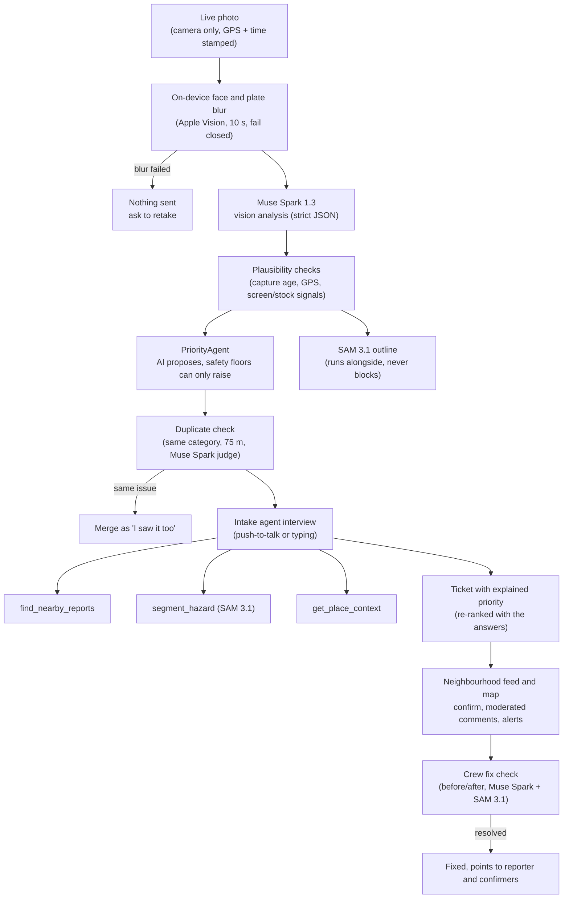
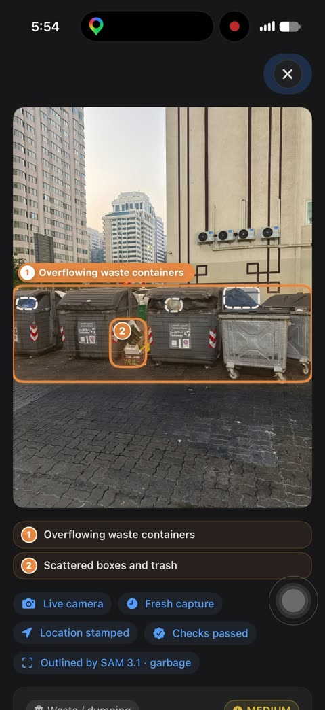
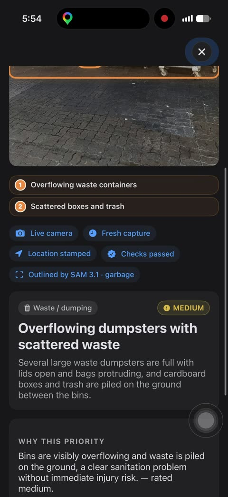
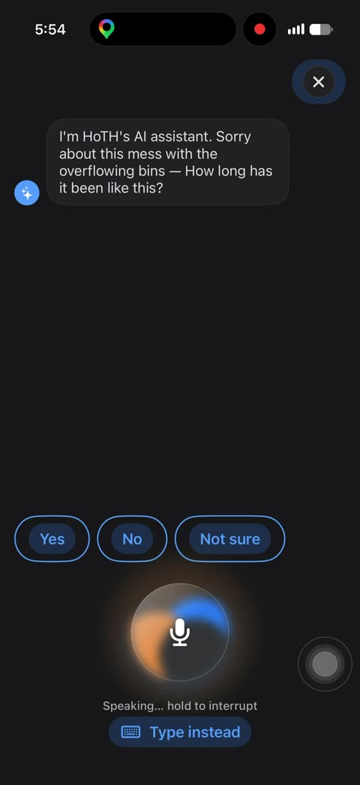
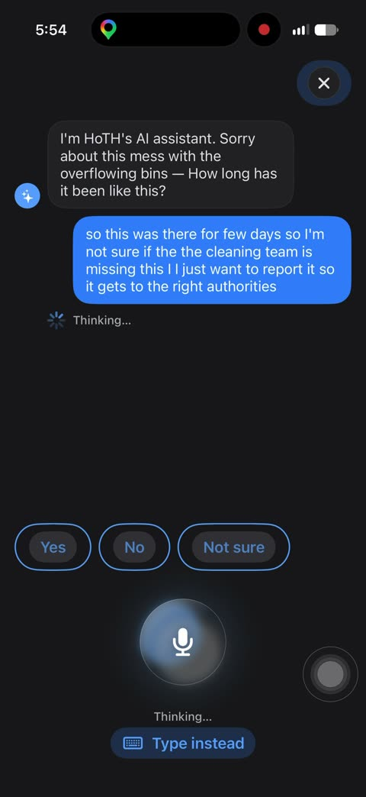
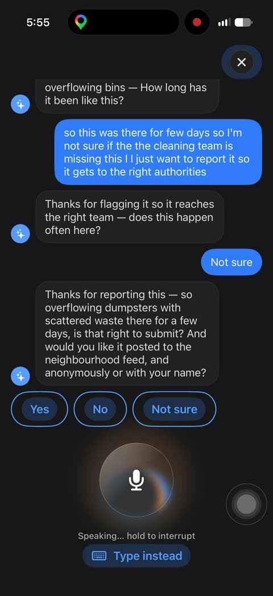
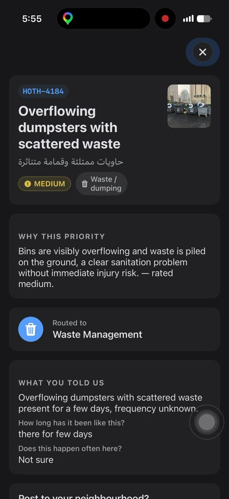
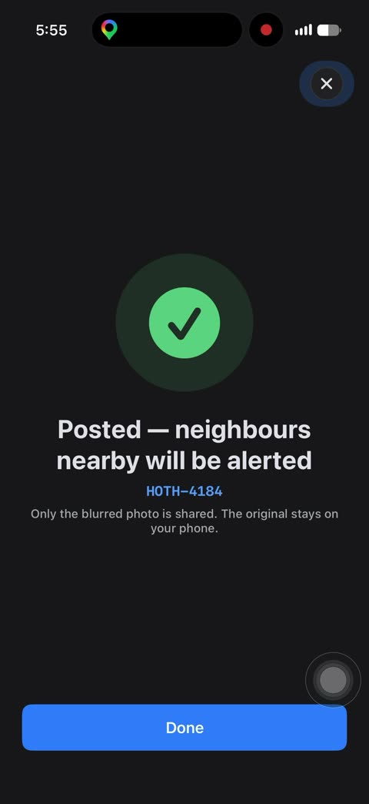

# HoTH: Heroes of the Hay

**Spot it. Say it. Neighbours back it. It gets fixed.**

*Hay* (حيّ) is Arabic for neighbourhood. HoTH is an iOS app for reporting unsafe public spaces: a broken spring rider in a playground, an open manhole, bare wires in a street cabinet, overflowing bins. A resident takes a live photo and answers a couple of spoken questions in Arabic or English. The app turns that into a structured ticket and explains why it got its priority. Neighbours confirm and comment, and the case closes once a crew's before/after photos pass an AI fix check.

The app runs on Meta's models: **Muse Spark 1.3**, **Muse Voice Transcribe** and **SAM 3.1**.

[](https://youtu.be/_vbVXJHLpaQ)

Demo video: <https://youtu.be/_vbVXJHLpaQ>

Built for the Meta Global AI Developer Hackathon by team **FomyIo**.

---

## Contents

- [Powered by Meta AI](#powered-by-meta-ai)
- [How it works](#how-it-works)
- [Screenshots](#screenshots)
- [Privacy and safety](#privacy-and-safety)
- [Evaluation](#evaluation)
- [Build and run](#build-and-run)
- [Project layout](#project-layout)
- [Limitations and roadmap](#limitations-and-roadmap)
- [Credits](#credits)
- [Team](#team)

More detail lives in [`docs/`](docs):
[architecture](docs/architecture.md) ·
[Meta models](docs/meta-models.md) ·
[privacy and safety](docs/privacy-and-safety.md) ·
[evaluation](docs/evaluation.md) ·
[development](docs/development.md)

## Powered by Meta AI

All three models are called from the phone through the Meta Model API (`https://api.meta.ai/v1`). Model ids live in one file, [`ios/HoTH/Resources/prompts.json`](ios/HoTH/Resources/prompts.json), next to every prompt and output schema.

| Model | Id | What it does in HoTH |
|---|---|---|
| **Muse Spark 1.3** | `muse-spark-1.3` | **Photo analysis:** category, bilingual title and description, hazard boxes, severity proposal with a reason, plausibility signals (screen, print, stock photo) and up to two follow-up questions. All of this comes back as one strict JSON schema.<br>**Intake agent:** runs the interview as a tool-calling loop. It can call `find_nearby_reports`, `segment_hazard` and `get_place_context`.<br>**Duplicate judge:** decides whether two nearby reports show the same physical issue.<br>**Fix check:** compares the before and after photos and boxes "what's left".<br>**Comment moderation** |
| **Muse Voice Transcribe** | `muse-voice-transcribe-1.0` | Push-to-talk speech to text. The app sends a language bias, Arabic + English or English, based on the resident's language. |
| **SAM 3.1** | `sam-3.1` | **Hazard outline:** concept segmentation from a short noun phrase per category, for example "pothole" or "exposed cable". It draws up to 3 boxes on the analysis photo and the ticket.<br>**Fix check:** shows "what's left" boxes when a repair is rejected.<br>**Intake agent:** the agent can call it on any short noun phrase through `segment_hazard`. |

Meta has no text-to-speech model, so spoken replies use Apple's on-device `AVSpeechSynthesizer` (ar-SA / en-US).

Request and response shapes, schemas and tool definitions are in [docs/meta-models.md](docs/meta-models.md).

## How it works



1. **Capture.** Only the live camera is offered, with no photo-library picker. The photo is stamped with time and GPS on the device and downsized to 1024 px.
2. **Blur before anything leaves the phone.** Apple Vision finds faces and plate-like text, and only the blurred JPEG is sent to Meta. If blurring fails or takes longer than 10 s, nothing is sent.
3. **Analysis.** Muse Spark returns one strict JSON object: category, title, hazard boxes, severity proposal and reason, plausibility signals and follow-up questions.
4. **Plausibility.** Deterministic checks reject or ask for a retake when:
   - the photo is older than 2 minutes
   - GPS is missing or worse than 100 m
   - the image looks like a screen, a print or a stock photo
   - the model sees no issue

   These checks are in `ios/Packages/HoTHCore/Sources/HoTHCore/Plausibility.swift`.
5. **Explained priority.** `PriorityAgent` takes the model's proposal and applies deterministic safety floors that can only raise it. For example, an open manhole is always CRITICAL, and broken child equipment with sharp metal is CRITICAL in a playground. Every factor appears as a chip under "Why this priority". See [privacy and safety](docs/privacy-and-safety.md#safety-floors) for the exact rules.
6. **SAM outline.** The same blurred JPEG goes to SAM 3.1 with the category's concept. Its boxes are drawn dashed over Muse Spark's numbered boxes. SAM has a 20 s budget, and a failure just means no overlay.
7. **Duplicate check.** HoTH looks for open reports of the same category within 75 m. For the nearest one, Muse Spark compares both blurred photos. If it says "same issue", the new report becomes a confirmation of the existing one.
8. **Voice interview.** The intake agent asks at most two short questions, reads the report back and asks whether to post it, anonymously or with a name.
   - Each turn is a Muse Spark tool loop, capped at 4 tool rounds.
   - It can look up open reports nearby and offer "a neighbour already reported this, confirm it instead?". It can also read child-relevant places near the photo and outline more hazards with SAM.
   - Voice goes through Muse Voice Transcribe, and replies are spoken on the device.
9. **Ticket.** The ticket shows the title in English and Arabic, the priority with its reason, the suggested team and the resident's answers. The priority is computed again with the interview answers, for example "children are using it now".
10. **Neighbourhood layer.** Feed and map, "I saw it too" confirmations, comments moderated by local checks plus Muse Spark, nearby-hazard alerts (high and critical only, within 1 km) and hero levels.
11. **Crew fix check.** A crew member photographs the repair. Muse Spark compares the before and after photos, both blurred. If it rejects the repair, SAM 3.1 boxes what's still broken. A case only becomes Fixed when the check passes, and then the reporter and confirmers get points.

## Screenshots

Real frames from a screen recording of the app on an iPhone. **Live test, Abu Dhabi, 3 Nov 2026.** All model calls are live (Muse Spark, SAM 3.1, Muse Voice Transcribe).

| | | |
|:---:|:---:|:---:|
| <br>Muse Spark hazard boxes (numbered) and SAM 3.1 outlines (dashed) | <br>Trust chips, "Outlined by SAM 3.1" and "Why this priority" | <br>The assistant asks one question and speaks it |
| <br>Push-to-talk answer, transcribed by Muse Voice Transcribe | <br>Read-back and the posting question | <br>Ticket HOTH-4184 |
| <br>Posted: only the blurred photo is shared | | |

This is a single-device build. "Neighbours nearby will be alerted" and "Routed to Waste Management" are labels inside the app. Nothing is sent to other users or to any authority (see [Limitations](#limitations-and-roadmap)).

## Privacy and safety

- **Blur before upload, fail closed.**
  - Faces and plate-like text found by Apple Vision on the phone are blurred before any photo goes to Meta. That covers vision, SAM, both photos in the duplicate judge, the agent's `segment_hazard` and both fix-check photos.
  - If the blur fails or takes more than 10 s, nothing is sent and the resident is asked to retake.
  - The feed only ever shows the blurred photo, and the original stays on the phone.
  - Detection can miss faces or plates, and the app's copy says so.
- **Live camera only.** There is no library picker. Plausibility checks stop old, location-less, screen, print and stock photos.
- **Deterministic safety floors.** The AI proposes a priority and `PriorityAgent` can only raise it. Broken child equipment with sharp metal or a fall risk is at least HIGH, and CRITICAL with child context (playground or school, a child in the photo, or children using it now). An open manhole is always CRITICAL. Electrical hazards are at least HIGH, and CRITICAL with child context, sparking or water nearby. The intake agent has no priority output.
- **Comment moderation.** Local checks block e-mail addresses, phone numbers and a short list of insults. Muse Spark then reviews the rest when a key is set.
- **Keys in the iOS Keychain.** The Meta API key is typed into Settings and stored in the Keychain (`HoTH.MetaKey`, this device only). No key is bundled in the app or committed to this repo.

What does leave the phone, and the honest gaps, are listed in [docs/privacy-and-safety.md](docs/privacy-and-safety.md).

## Evaluation

`tools/eval/run_eval.py` runs the exact prompts and schemas from `prompts.json` against 48 labelled images: 29 Wikimedia Commons photos and 19 AI-generated images. It covers 5 before/after fix pairs and 6 same-issue pairs. Results below are from the live run on 2026-11-01 (`tools/eval/results.md`).

| Metric | Result |
|---|---|
| Live API calls / estimated cost | 62 / $0.42 |
| Category accuracy (plausible items) | 36/42 (86%) |
| Urgent-hazard recall (final ≥ high) | 11/12 (92%) |
| Implausible images flagged | 6/6 (100%) |
| Fix-verification accuracy | 5/5 (100%) |
| Same-issue (duplicate) accuracy | 6/6 (100%), easy pairs: 3 crop/rotate variants and 3 clear negatives |
| Latency mean / p95 per call | 7.2 s / 11.6 s |

The weak spots:

- Playground category accuracy is 4/7 (57%). Small or subtle breakage is often read as "not an issue".
- 6 of 39 plausible issue images (15%) were wrongly flagged as implausible. Two are Wikimedia photos and four are AI-generated, three of those being "after repair" images.

Full tables, method and caveats: [docs/evaluation.md](docs/evaluation.md).

## Build and run

Requirements: macOS with **Xcode 26**, an iOS 17+ simulator or device, and [XcodeGen](https://github.com/yonaskolb/XcodeGen) (`brew install xcodegen`).

```bash
make gen     # generate ios/HoTH.xcodeproj from ios/project.yml
make build   # build for the iOS Simulator
make test    # app unit + UI tests on the first available iPhone simulator
cd ios/Packages/HoTHCore && swift test   # core logic tests (macOS, no simulator)
```

Then open `ios/HoTH.xcodeproj` and run the `HoTH` scheme. To run on a device, set your team under Signing.

**Meta API key.** Open **Settings → Meta Model API key**, paste the key and save. It is stored in the iOS Keychain. In DEBUG simulator builds the app also reads a `META_API_KEY` scheme environment variable.

**Demo mode** is on by default (Settings):

- It seeds a fictional demo community, with neighbours, reports and comments, and allows the bundled sample photos.
- Without a key, the sample photos use canned analyses and nothing is sent.
- With a key, they go through the real models.
- "Reset app" in Settings restores first-launch state.

Last observed test results:

- HoTHCore: `swift test` ran 159 tests, 0 failures, 10 skipped. The skipped ones are the opt-in `LiveMetaTests`, which need `META_API_KEY`.
- App unit tests: 187 tests, 1 skipped.
- UI tests pass. The four `DemoCaptureUITests` scenes are opt-in.

See [docs/development.md](docs/development.md).

## Project layout

| Path | What |
|---|---|
| `ios/HoTH/` | SwiftUI + SwiftData app (iOS 17+) |
| `ios/HoTH/App/` | App entry, `AppServices` (Keychain key, Meta client, prompts, settings), tabs, reset |
| `ios/HoTH/Features/` | Report flow, feed and case detail, map, crew, hero profile, onboarding, settings |
| `ios/HoTH/Voice/` | Push-to-talk recording, transcription and on-device speech |
| `ios/HoTH/Privacy/` | `FaceAndPlateBlur` (on-device redaction) and the DEBUG upload audit |
| `ios/HoTH/Models/` | SwiftData models and the demo seed loader |
| `ios/HoTH/Resources/prompts.json` | All prompts, JSON schemas, tool definitions, SAM concepts and model ids |
| `ios/Packages/HoTHCore/` | Pure Swift package: Meta client (Responses, tools, transcribe, SAM), priority floors, plausibility, dedup, rewards, schemas |
| `ios/HoTHTests/`, `ios/HoTHUITests/` | App unit and UI tests |
| `tools/eval/` | Offline eval of the app's prompts on a labelled image set |
| `docs/` | Architecture, Meta model usage, privacy, evaluation, development |

## Limitations and roadmap

Limitations:

- **No backend.** Everything is single-device, in local SwiftData.
  - The "neighbourhood" is the fictional demo community seeded on first launch.
  - Neighbour alerts are local notifications, simulated in demo mode.
  - "Routed to" is a category-to-team label. Nothing is dispatched to any authority.
  - The crew role is a Settings toggle with no sign-in.
- **Blur can miss.** Face and plate detection is Apple Vision on the device and can miss some faces and plates. Blur timing on a real iPhone has not been measured yet. Simulator runs took 0.21–0.38 s on the spring rider photo. That photo has no faces or plates, so this measures detection only, not the blur rendering.
- **Playground recall.** Playground category accuracy is 57% in the eval. When Muse Spark calls a photo "not an issue", the safety floors never get a chance to fire.
- **Small eval.** It is one run on 48 images, 19 of which are AI-generated. The intake agent, SAM, transcription and moderation are not in the offline eval. They are only covered by opt-in live smoke tests (`LiveMetaTests`).
- **Arabic speech.** Arabic transcription has only been checked on synthetic (`say`-generated) clips, not on recordings of real Gulf Arabic speakers.
- **TTS is on-device** (`AVSpeechSynthesizer`), because Meta has no text-to-speech model.
- **SAM masks are not drawn.** The app uses SAM's boxes. Masks are requested but left encoded.

Roadmap ideas, none of which are built:

- a shared backend so reports reach real neighbours and municipal teams
- measuring blur latency and recall on devices
- a larger, real-photo playground set
- scripted transcripts to evaluate the intake agent

## Credits

- Image sources and licences: [ios/HoTH/Resources/IMAGE_CREDITS.md](ios/HoTH/Resources/IMAGE_CREDITS.md) (bundled app images) and [tools/eval/dataset/ATTRIBUTION.md](tools/eval/dataset/ATTRIBUTION.md) (eval dataset). CC BY-SA images remain under their original licences.
- Change history: [CHANGELOG.md](CHANGELOG.md).

## Team

**FomyIo**: Mosaab Yassir LAFRIMI (solo), Abu Dhabi, UAE.
