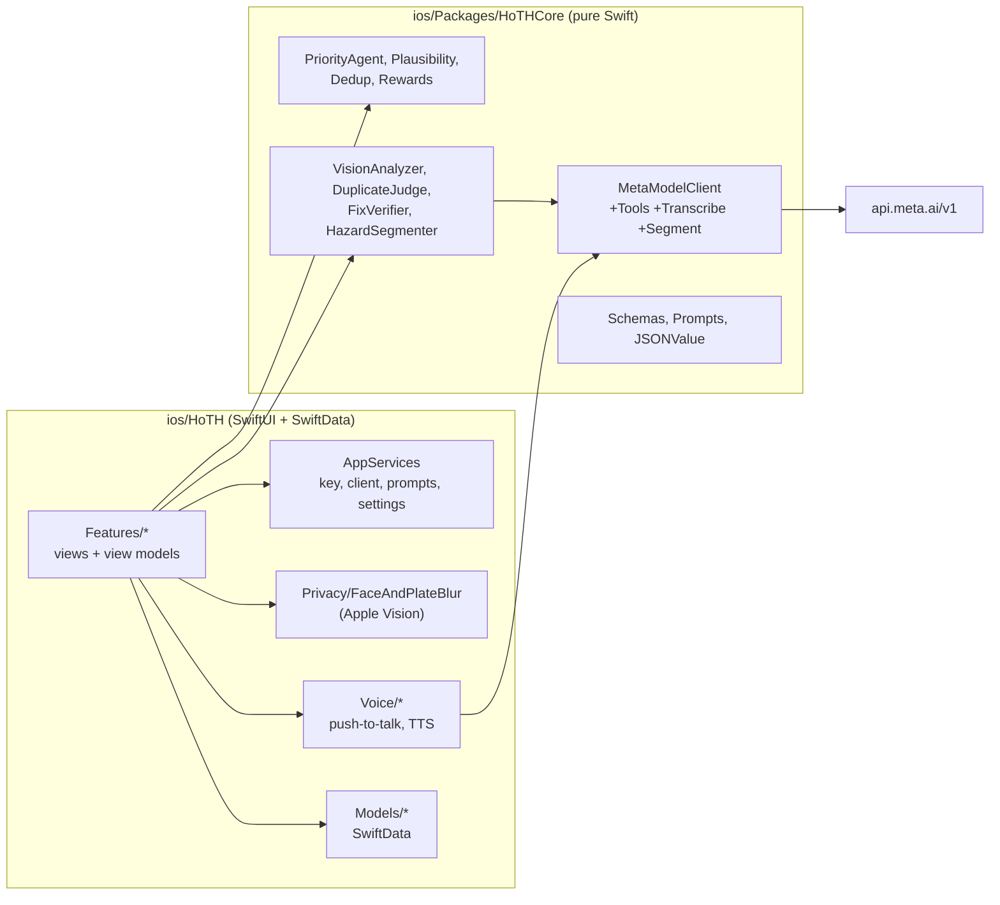

# Architecture

HoTH is a single SwiftUI app plus one local Swift package. There is no server: the phone talks directly to the Meta Model API, and all community data lives in SwiftData on the device.

## Modules

| Module | Path | Responsibility |
|---|---|---|
| App shell | `ios/HoTH/App/` | `HoTHApp` builds the SwiftData container and seeds the demo community. `RootTabs` holds Feed, Map, Report (centre button), Hero or Crew, and Settings. `AppServices` is the shared services object. `AppResetter` handles "Reset app". |
| Report flow | `ios/HoTH/Features/Report/` | Capture (`CaptureService`, `CaptureView`), `ReportFlowModel` (analyse, plausibility, SAM, priority, dedup, interview, post), `ChatIntakeModel` (interview, tool loop), `IntakeTools` (the agent's tools), `TicketView`, `AnalysisCardView`, `HazardOutline` (SAM overlay). |
| Feed | `ios/HoTH/Features/Feed/` | Feed cards, case detail, comments with `CommentModeration`, `NeighbourAlerts`, feed map. |
| Crew | `ios/HoTH/Features/Crew/` | Crew queue, `FixCheckModel` (blur, verify, SAM "what's left"), `CrewWorkflow` (status changes and fix rewards), Fixed celebration. |
| Voice | `ios/HoTH/Voice/` | `PushToTalkModel` (idle, listening, transcribing, thinking, speaking), `PushToTalkAudio` (AVAudioRecorder, AVSpeechSynthesizer, `MetaSpeechTranscriber`), DEBUG `FileVoiceRecorder`. |
| Privacy | `ios/HoTH/Privacy/` | `FaceAndPlateBlur` (detect and blur, `redactForUpload`, 10 s timeout) and `UploadAudit` (DEBUG log proving each upload was redacted first). |
| Models | `ios/HoTH/Models/` | SwiftData `@Model` classes and `SeedLoader` (reads `Resources/seed.json`). |
| Core | `ios/Packages/HoTHCore/` | Everything that does not need UIKit: the Meta client, schemas, prompt loading, deterministic rules. Builds and tests on macOS with `swift test`. |

## HoTHCore boundaries

`HoTHCore` imports only Foundation, CoreGraphics and ImageIO. It never touches the Keychain, SwiftData, UIKit or the camera.

- **Network:** `MetaModelClient` is the only type that makes HTTP calls. It gets the key through the `APIKeyProvider` protocol at call time and never stores it. Errors are a typed `ModelAPIError` that never carries the key, image bytes or audio. Error bodies are scrubbed of anything shaped like a key.
- **AI wrappers:** `VisionAnalyzer`, `DuplicateJudge`, `FixVerifier` and `HazardSegmenter` fill a prompt from `Prompts` and decode into the types in `Schemas.swift`.
- **Pure rules:** `PriorityAgent`, `Plausibility`, `Dedup`, `Rewards` and `DistanceFormatting` are pure functions with no I/O. The app uses them as the source of truth for priority, retakes, duplicate radius and points.
- **Prompts:** `Prompts(bundle:)` decodes `prompts.json`. The same file is read by the Python eval, so the app and the eval use identical prompts and schemas.

The app owns everything with side effects: blur, capture, persistence, notifications, and the agent's tool implementations, which read SwiftData.

## AppServices wiring

`AppServices.shared` (`ios/HoTH/App/AppServices.swift`) is a `@MainActor` `ObservableObject`. It holds:

| Member | What it is |
|---|---|
| `keyProvider` | `KeychainAPIKeyProvider`: Keychain service `HoTH.MetaKey`, account `default`, `kSecAttrAccessibleAfterFirstUnlockThisDeviceOnly`. In DEBUG simulator builds it falls back to the `META_API_KEY` environment variable. |
| `modelClient` | One `MetaModelClient` (60 s timeout, reasoning effort `low`). |
| `prompts` | Decoded `prompts.json`. A missing or invalid file is a packaging bug, so the app stops with `preconditionFailure`. |
| Settings | Stored in UserDefaults under the `hoth.settings.*` keys: demo mode (default on), role (resident or crew), vision and text model overrides, language (system, en or ar), voice-first interview (default on), interview agent tools (default on). |
| `visionModel` / `textModel` | Resolved as the override if one is set, otherwise the `prompts.json` default (`muse-spark-1.3`). |
| `isUITestRun` / `isDemoCaptureRun` | DEBUG-only launch flags. They are always false in Release builds. See [development.md](development.md#test-hooks). |

Feature code builds model-backed helpers from these services when it needs them:

- `hazardOutliner()` builds the SAM outliner. It returns nil without a key or during UI tests.
- `ModelCommentModerator`, `LiveFixVerifier` and `MetaSpeechTranscriber` are built the same way.

Each seam is a small protocol: `HazardOutlining`, `CommentModerator`, `FixVerifying`, `SpeechTranscribing`, `VoiceRecording`, `SpeechSpeaking`. Tests inject fakes through them.

## Data model

SwiftData schema (`ios/HoTH/Models/HoTHStore.swift`): `Report`, `Comment`, `Vote`, `Neighbour`, `PointsEvent`.

| Model | Key fields |
|---|---|
| `Report` | Category, English and Arabic title and summary, latitude and longitude, place name, photo files (original and blurred), `analysisJSON`, priority level, score and reason (en and ar), `signalsJSON`, status, `isPosted`, `isAnonymous`, `confirmations`, `mergedReportIDs`, fix photo and `fixedAt`, `isDemoSeed`. |
| `Comment` | Author, report, text, moderation status. |
| `Vote` | Voter and report. |
| `Neighbour` | Display name, neighbourhood name, points, trust, `isCurrentUser`. |
| `PointsEvent` | User, points delta, reason, report id. |

Photos are JPEG files in the app's Documents folder. Records keep only file names. The blurred file is the one shown in the feed (`displayPhotoFileName`).

The demo community comes from `ios/HoTH/Resources/seed.json`: 9 neighbours, 14 reports and 19 points events, all fictional and placed around Khalifa City, Abu Dhabi. Every seeded record has `isDemoSeed = true`.

## Report flow, step by step

`ReportFlowModel.submit(_:context:)` in `ios/HoTH/Features/Report/ReportFlowModel.swift`:

1. Start the MapKit point-of-interest lookup (100 m radius, 1.5 s timeout) alongside the analysis. It is skipped in demo mode, without GPS, and on the simulator.
2. Blur with `FaceAndPlateBlur.redactForUpload`. If that fails, stop with the retake message.
3. Run `VisionAnalyzer.analyze` on the blurred JPEG.
4. Run `Plausibility.evaluate`. Any status other than accepted shows a retake screen.
5. Start the SAM outline task on the same blurred JPEG. It is not awaited.
6. Compute `PriorityAgent.decide` with the nearby place.
7. Run the duplicate check (`Dedup.candidates` within 75 m, then `DuplicateJudge` on both blurred photos). A match merges into the existing report.
8. Show the analysis card. The safety sheet comes first when the hazard is dangerous. Then the interview runs, and its answers re-run `PriorityAgent` before the ticket.

Each run has a `runID`. A late reply from an abandoned run, after a retake or close, is dropped instead of being applied to the new report.

## Concurrency

- View models (`ReportFlowModel`, `ChatIntakeModel`, `PushToTalkModel`, `FixCheckModel`, `IntakeToolbox`) and `AppServices` are `@MainActor`.
- `HoTHCore` types are `Sendable`. `MetaModelClient` is a `final class` with only immutable stored properties.
- `ToolLoop.run` takes an `isolation` parameter, so tool executors run on the caller's actor (the main actor for `IntakeToolbox`).
- Timeouts use structured concurrency. `HazardSegmenter.withTimeout` races the call against a sleep (20 s). `FaceAndPlateBlur.firstResult` returns a fallback after 10 s. `NearbyPlaces.lookUp` uses 1.5 s.
- Cancellation: `MetaModelClient` rethrows `CancellationError` (not a network error) when a task or `URLSession` request is cancelled, so abandoned work is dropped silently. `ToolLoop` checks for cancellation between rounds.
- Build setting: `SWIFT_STRICT_CONCURRENCY: minimal` in `ios/project.yml`.
